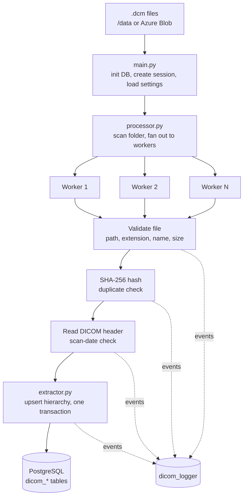
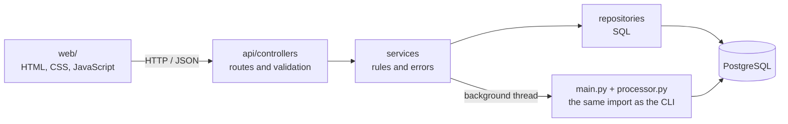
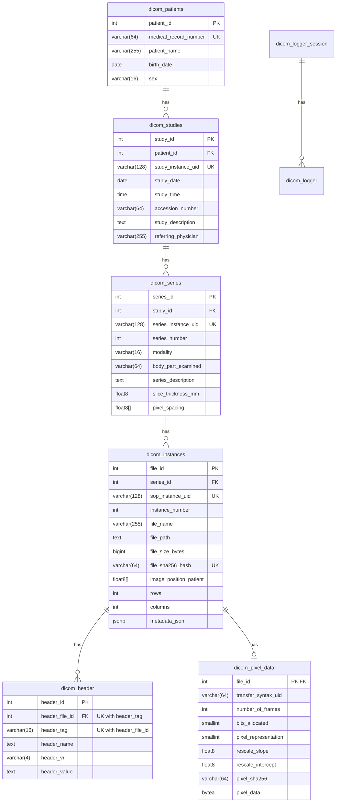

# DICOM Clinical Data ETL Pipeline


A containerized Python ETL pipeline that ingests DICOM medical files, validates them, extracts their metadata, and loads everything into a normalized PostgreSQL database that follows the DICOM hierarchy (Patient → Study → Series → Instance) using parallel workers, content-hash deduplication, and structured database logging.

On top of the pipeline back-end sits a FastAPI REST API and a small web interface, where you can start imports and follow the progress, browse the hierarchy, view the CT slices, download new files from Azure Blob Storage, and change the import settings.

The front-end code (html, JS, css) was written with the help of an AI assistant as a demo client to talk to the API.

---

## Table of contents

- [Features](#features)
- [Architecture](#architecture)
- [REST API and web interface](#rest-api-and-web-interface)
- [Database schema](#database-schema)
- [Tech stack](#tech-stack)
- [Getting started](#getting-started)
- [Configuration](#configuration)
- [How a file is processed](#how-a-file-is-processed)
- [Performance](#performance)
- [Testing and CI](#testing-and-ci)
- [Project structure](#project-structure)
- [Design decisions](#design-decisions)
- [Security and privacy](#security-and-privacy)
- [Data sources](#data-sources)
- [Author](#author)

---

## Features

| Area | What it does |
|---|---|
| **Parallel processing** | Files are processed concurrently with `ProcessPoolExecutor`. The worker count is configurable, with sequential fallback. 4 workers import about 4× faster than sequential ([benchmark](#performance)). |
| **Relational modelling** | Patient → Study → Series → Instance hierarchy, loaded with idempotent `INSERT ... ON CONFLICT` upserts. |
| **Complete header capture** | Every DICOM tag (except pixel data) is stored as `JSONB` for flexible queries, and as one row per tag for relational queries. Nested sequences are kept in full, binary values are summarised, and both use the DICOM JSON tag format (`00080060`). Bulk inserts use `execute_values`. |
| **Pixel data storage** | The image bytes of every file are stored in their own table, with a SHA-256 checksum and the tags needed to rebuild the image (dimensions, bit depth, rescale slope/intercept for Hounsfield units). |
| **Input validation** | Recognises DICOM files by their `.dcm` extension or for files without one, by the `DICM` marker in the file header (To make sure DICOM files without an extension aren't skipped), anything else is skipped. Then checks the filename whitelist and size limits, and rejects scans whose own date (`StudyDate`) is too old or in the future. |
| **Anonymised files** | Files with empty `PatientID` are grouped by their `StudyInstanceUID` under a stable placeholder ID, so the slices of one anonymised study stay together instead of becoming one patient per file. |
| **Path-traversal protection** | Paths are resolved with `realpath` and `commonpath`, so `..` and symlink escapes outside the base folder are rejected. |
| **Duplicate prevention** | SHA-256 content hashing and unique constraints on DICOM UIDs. |
| **Transactional safety** | Each file is one transaction. A failure at any step rolls back the whole patient → instance chain. So there's nothing left half-imported. |
| **Structured logging** | Console and critical-file logging, and per-session, per-file event rows in PostgreSQL (module, function, line, process, thread, exception type, stack trace). |
| **Runtime configuration** | Import limits and worker count are read from the `dicom_settings` table, so no manual set is needed. They can be edited from the web interface. |
| **REST API** | FastAPI app with a controllers → services → repositories structure, Pydantic validation, and consistent JSON errors (404, 409, 422, 503). |
| **Web interface** | Dashboard, browser for patients → studies → series, slice viewer, import page with live progress, import history, settings and a reset option that asks for confirmation. Written with HTML, CSS and JavaScript served by the API. |
| **Image viewer** | Rebuilds each slice from the stored pixel bytes with NumPy (rescaled to Hounsfield units) and returns it as PNG with an automatic grey-level window. |
| **Concurrency safety** | A PostgreSQL advisory lock makes command-line imports, API imports, Azure syncs and resets exclude each other, so a reset can never run in the middle of an import. |
| **Cloud ingestion** | Optionally downloads new ".dcm" files from a public Azure Blob Storage container, before a command-line import or with the **Sync from Azure** button in the web interface. |
| **Profiling** | Opt-in `@profiler` decorator (via `line_profiler`). Off by default with zero overhead; set `DICOM_PROFILE=1` to write line-by-line timings to one `profiler_logs_<pid>.txt` per process. |
| **Containerized** | Docker Compose runs PostgreSQL 15 with a health check, and the pipeline starts only once the database is ready. The pipeline image is a multi-stage build (no compiler in the final image) and runs as a non-root user. |

---

## Architecture



The API reuses the same pipeline. It is split into three layers, so each one has a single job:



- **Controllers** declare the routes and let Pydantic check the request.
- **Services** hold the rules: masking patient names, checking that a parent exists, refusing an import while another one runs.
- **Repositories** only run SQL and return plain dictionaries.

---

## REST API and web interface

Start the API (the database must be running, for example with `docker compose up -d db`):

```bash
python -m api
```

Then open `http://127.0.0.1:8000` for the web interface, or `http://127.0.0.1:8000/docs` for the interactive API documentation that FastAPI generates.

| Method | Endpoint | What it does |
|---|---|---|
| `GET` | `/api/health` | Checks that the server is up |
| `GET` | `/api/stats` | Counts of patients, studies, series and instances, and stored bytes |
| `GET` / `PUT` | `/api/settings` | Reads or replaces the import settings |
| `GET` | `/api/patients` | Patients, with masked names (`limit`, `offset`) |
| `GET` | `/api/patients/{id}/studies` | Studies of one patient |
| `GET` | `/api/studies/{id}/series` | Series of one study |
| `GET` | `/api/series/{id}/instances` | Slices of one series |
| `GET` | `/api/instances/{id}/image` | One slice as PNG |
| `GET` | `/api/folders` | Folders inside `data/` that can be imported |
| `POST` | `/api/imports` | Starts an import in the background and answers `202` |
| `GET` | `/api/imports` | Import history with counts per outcome and status |
| `POST` | `/api/admin/reset` | Drops and recreates the tables; the body must be `{"confirm": "RESET"}` |
| `GET` | `/api/azure` | Whether an Azure container is configured |
| `POST` | `/api/azure/sync` | Downloads new files from the Azure container into `data/azure` |

Imports can take minutes, so `POST /api/imports` answers straight away with the import's ID, and the web page polls `GET /api/imports` every second to show the progress. Imports started from the command line show up in the history too, and their status (running or finished) comes from the advisory lock.

Errors always have the same shape, `{"detail": "..."}`, for example `409 {"detail": "cannot reset while an import or Azure sync is running"}`, and the web interface shows that message to the user.

---

## Database schema



---

## Tech stack

| Area | Tools |
|---|---|
| Pipeline | Python 3.11, pydicom, psycopg2, `ProcessPoolExecutor` |
| Database | PostgreSQL 15 (`JSONB`, `BYTEA`, upserts, advisory locks) |
| API | FastAPI, Pydantic, Uvicorn |
| Images | NumPy, Pillow |
| Web interface | HTML, CSS, JavaScript (no framework) |
| Infrastructure | Docker, Docker Compose, Azure Blob Storage |
| Quality | pytest, GitHub Actions, line_profiler |

---

## Getting started

### Prerequisites

- Docker and Docker Compose (recommended), **or** Python 3.11+ and a PostgreSQL instance
- Nothing else: five de-identified sample files are included in [`samples/`](samples/)

### 1. Clone and configure

```bash
git clone https://github.com/vybezy/dcm-data-etl.git
cd dcm-data-etl
```

Copy the .env template:

```bash
cp .env.example .env
```

To download source files from Azure Blob Storage, set `AZURE_CONTAINER_URL` in `.env`. The template already points to my public demo container `raw-dicom-data`(includes some sample '.dcm' files), which is read-only and needs no key; leave it empty to use only the files in `./data`.

### 2. Add data

Copy the samples into `./data`, or put your own `.dcm` files there:

```bash
cp samples/*.dcm data/          # Windows PowerShell: Copy-Item samples\*.dcm data\
```

The samples are five CT slices from the public LIDC-IDRI collection (CC BY 3.0); see [`samples/README.md`](samples/README.md) and [Data sources](#data-sources) for the citation.

Sub-folders work too (example: `data/chest` and `data/kidney`) the web interface lists them, so you can import one at a time.

### 3. Run with Docker (recommended)

```bash
docker compose up --build
```

PostgreSQL is exposed on host port `5433`. Inside Compose, the pipeline overrides `DB_HOST` to `db` automatically and waits for the database health check before starting.

### Run the API and web interface

Start only the database in Docker, and run Python on your machine:

    docker compose up -d db
    python -m venv .venv
    .venv\Scripts\activate            # macOS/Linux: source .venv/bin/activate
    pip install -r requirements-dev.txt
    python -m api

Then open http://127.0.0.1:8000.

### Command-line options

```bash
python main.py [PATH] [--workers N] [--dry-run] [--reset] [--no-azure]
```

| Option | Meaning |
|---|---|
| `PATH` | A folder, a single `.dcm` file or a wildcard such as `"./data/*.dcm"`. Defaults to `/data` in Docker, otherwise `./data`. |
| `--workers N` | Parallel worker processes (`0` = sequential). Overrides the `workers` setting in the database. |
| `--dry-run` | Run every validation and duplicate check without inserting anything. |
| `--reset` | Drop and recreate all pipeline tables first. **Deletes all imported data.** |
| `--no-azure` | Skip the Azure Blob Storage download even if `AZURE_CONTAINER_URL` is set. |

Data is kept between runs by default, so re-running the pipeline on the same folder reports the already-imported files as `duplicate` instead of inserting them again.

The process exits with `0` when no file errored, `1` when at least one file errored, `2` when the input path does not exist, and `3` when another import or a reset is already running. This makes it easy to use in scripts and CI.

### Profiling

Line-by-line profiling is off by default. To profile a run, install the development dependencies (which include `line_profiler`) and set `DICOM_PROFILE=1`:

```bash
pip install -r requirements-dev.txt
DICOM_PROFILE=1 python main.py ./data --workers 0     # Windows PowerShell: $env:DICOM_PROFILE=1; python main.py ./data --workers 0
```

Each process writes its timings to its own `profiler_logs_<pid>.txt`. Running with `--workers 0` keeps everything in one file.

---

## Configuration

Import behaviour is tunable at runtime through the `dicom_settings` table:

| Key | Default | Meaning |
|---|---|---|
| `min_file_size` | 100 KB | Smaller files are rejected |
| `max_file_size` | 99 MB | Larger files are rejected |
| `max_file_age_months` | 1200 | Scans older than this are rejected, judged by the DICOM `StudyDate` (falling back to `SeriesDate`, `AcquisitionDate`, `ContentDate`), not by the file's timestamp on disk |
| `workers` | 4 | Parallel worker processes (`0` = sequential) |

To start from empty tables, run with `--reset` or set `RESET_TABLES=true` in `.env`; either one drops and recreates all pipeline tables before the import, so set it back to `false` afterwards.

The defaults are defined once, in `DEFAULT_SETTINGS` in `config.py`. They are written to the table on first run and never overwrite a value you have changed.

Every file ends in exactly one status, summarized at the end of each run:

`inserted` · `duplicate` · `invalid` · `skipped` · `dry_run` · `error`

---

## How a file is processed

1. **Path check:** resolve the real path and confirm it is inside the base folder.
2. **Is it DICOM:** a `.dcm` file is accepted straight away; a file without that extension is accepted only if bytes 128–131 of its header are `DICM`. Anything else (such as a citation text file in the same folder) is logged as `skipped`.
3. **Filename:** must match the filename whitelist.
4. **Size:** must be within the configured limits.
5. **Hash and duplicate check:** compute SHA-256 and look it up in `dicom_instances`.
6. **Header and scan date:** read the DICOM file once (pixel data included, except on a dry run) and reject the file if its `StudyDate` is older than `max_file_age_months` or more than a day in the future. Files with no date at all are accepted with a warning. `--dry-run` stops after this step.
7. **Extraction (one transaction):** upsert patient → study → series, insert the instance, bulk-insert all header tags, then store the pixel data.
8. **Commit or roll back:** success commits and logs `SUCCESS`. Any error rolls back the entire file, so no partial hierarchy is left behind.

Each step logs to the console and, when a session exists, to `dicom_logger`.

---

## Performance

Measured with [`benchmark.py`](benchmark.py): the 351 CT slices of the full sample series (about 40 MB) are imported from an empty database for each worker count, and each value is the median of 3 runs.

Environment: Docker Desktop on Windows, 12 logical CPU cores visible to the container, Python 3.11, PostgreSQL 15 in a second container.

| Workers | Time | Files/sec | Speed-up |
|---|---|---|---|
| 0 (sequential) | 44.42 | 7.9 | 1.00x |
| 1 | 46.88 | 7.5 | 0.95x |
| 2 | 18.84 | 18.6 | 2.36x |
| 4 | 16.24 | 21.6 | 2.74x |
| 8 | 15.92 | 22.0 | 2.79x |

To reproduce (this resets the pipeline tables before a run):

```bash
docker compose run --rm etl_pipeline python benchmark.py
```

---

## Testing and CI

```bash
pip install -r requirements-dev.txt
python -m pytest -v
```

Dependencies are split in two files: `requirements.txt` holds what the pipeline needs to run, and `requirements-dev.txt` adds the test and profiling tools on top of it.

All suites live in [`tests/`](tests/):

| Suite | What it covers | Needs a database |
|---|---|---|
| `test_api.py` | Every endpoint through FastAPI's `TestClient`: status codes, validation errors, 404s, 409s while an import or reset runs, the background import, PNG responses | No (mocked) |
| `test_services.py` | Name masking, image rebuilding (rescale, windows, compressed images rejected), PNG output | No |
| `test_repositories.py` | SQL and parameters sent by each repository, rows mapped to dictionaries | No (mocked) |
| `test_main.py` | Command-line options, folder / file / wildcard input, exit codes (including busy), `--reset`, settings fallback, the lock released after a crash | No (mocked) |
| `test_processor.py` | Filename validation, path-traversal and symlink protection, `DICM` marker detection, hashing, every validation rejection, scan-date checks, duplicate, dry-run, rollback and error paths | No (mocked) |
| `test_extractor.py` | Date/time parsing, tag cleaning, nested sequences, binary values, JSON serialization, header bulk-insert payload, patient and study upserts | No (mocked) |
| `test_database.py` | Connections are always committed or rolled back and closed; session creation; settings loading; DB event logging; the import lock | No (mocked) |
| `test_logger.py` | Plain-text labels, Unicode-safe console output, UTF-8 log file | No |
| `test_passwords.py` | Password rules (8 to 128 printable English characters, a capital, a digit, a special character, no spaces), PBKDF2 hashing with a random salt, checking right and wrong passwords | No |
| `test_profiler.py` | Profiler is off by default and falls back cleanly without `line_profiler` | No |
| `test_azure.py` | Azure Blob download: skipped without a container URL, failures logged, existing files kept | No (mocked) |
| `test_benchmark.py` | Benchmark maths (median, files/sec, speed-up), `.dcm` counting, stopping on a failed import | No (mocked) |
| `test_integration.py` | Real DICOM files into real PostgreSQL: full hierarchy, JSONB, deduplication, upsert sharing, transaction rollback, DB event logging, scan-date rejection, schema indexes, multi-process import, pixel data stored byte for byte, the advisory lock shared between connections, and the user tables (unique usernames, rights 1 to 3, sessions deleted with their user, users kept after a reset) | Yes |

### Running the integration tests locally

The integration tests wipe the tables, so they only run when `TEST_DB_NAME` is set and contains `test`. Otherwise they are skipped.

```bash
docker run -d --name dcm_test_db \
  -e POSTGRES_PASSWORD=postgres -e POSTGRES_DB=dicom_test \
  -p 5434:5432 postgres:15

export TEST_DB_NAME=dicom_test TEST_DB_USER=postgres \
       TEST_DB_PASSWORD=postgres TEST_DB_PORT=5434
python -m pytest -v
```

### Continuous integration

GitHub Actions (`.github/workflows/ci.yml`) runs on every push and pull request. It starts a PostgreSQL 15 service container, installs the dependencies from `requirements-dev.txt` and runs the full suite, including the integration tests.

---

## Project structure

```
.
├── .github/workflows/ci.yml   # CI: PostgreSQL service + pytest
├── data/                      # input .dcm files
├── samples/                   # 5 sample .dcm files
├── tests/                     # unit and integration tests (pytest)
├── api/
│   ├── main.py                # FastAPI app, error handlers, serves web/
│   ├── __main__.py            # python -m api starts the server
│   ├── schemas.py             # Pydantic request and response models
│   └── controllers/           # routes: stats, settings, browse, imports, images, admin, azure
├── services/                  # rules: masking, import jobs, image rebuilding, Azure sync, passwords, errors
├── repositories/              # SQL only, one module per area
├── web/                       # index.html, style.css, app.js
├── main.py                    # entry point: command-line options, init DB, build options
├── processor.py               # validation, hashing, dedupe, scan-date check, parallel orchestration
├── extractor.py               # DICOM value conversion and hierarchical upserts
├── database.py                # connection handling, sessions, DB event logging, settings
├── db_init.py                 # schema creation and reset
├── auth_db.py                 # user and session tables (kept when the pipeline tables are reset)
├── config.py                  # database credentials from .env and DEFAULT_SETTINGS
├── logger.py                  # console and file logging, pretty_log
├── utils.py                   # ImportOptions, profiler, exception handler, Azure download
├── benchmark.py               # import speed for different worker counts
├── .env.example               # template for .env
├── .dockerignore              # keeps .env and data out of the Docker image
├── Dockerfile                 # multi-stage build, runs as non-root user
├── docker-compose.yml
├── requirements.txt           # pinned runtime dependencies (installed in the Docker image)
└── requirements-dev.txt       # runtime dependencies + pytest and line_profiler
```

---

## Design decisions

- **Process pool instead of threads.** Parsing and hashing are CPU-bound, so separate processes avoid the GIL. Each worker opens its own database connection, so no connections are shared across processes.
- **One transaction per file.** The hierarchy is written in such way it keeps the database consistent even when a single file is malformed.
- **Upserts instead of check-then-insert.** `ON CONFLICT` on the DICOM UIDs makes the pipeline idempotent and safe under concurrent workers.
- **No duplicate indexes.** PostgreSQL already builds an index for every `UNIQUE` constraint (patient MRN, study/series UIDs, SHA-256 hash, and `(header_file_id, header_tag)`), so the schema adds explicit indexes only on columns that are not already covered, such as foreign keys, modality, tag and the `JSONB` GIN index.
- **`JSONB` plus a per-tag table.** `JSONB` serves flexible whole-header queries, while `dicom_header` supports indexed relational lookups by tag.
- **Pixel data in its own table.** At about 512 KB per CT slice, the image bytes are far larger than the metadata, so they live in `dicom_pixel_data` and metadata queries never read them. They are stored exactly as in the file, so storage is lossless and works for compressed transfer syntaxes too.
- **Settings in the database.** Operators can tune limits and parallelism without rebuilding the image. The command line and the API convert them with the same function, so they can never read them differently.
- **One advisory lock for every entry point.** The command line, the API's import, the Azure sync and the API's reset all take the same PostgreSQL advisory lock with `pg_try_advisory_lock`, which answers straight away instead of waiting. The lock lives in the database because that is the only thing the separate processes share, and it belongs to its own connection, so PostgreSQL releases it automatically if a process crashes.
- **Layers in the API.** Controllers, services and repositories each have one job, and the tests replace the repositories while running a mock.
- **Imports as background jobs.** An import can take minutes, so the API answers `202` with an ID and the web page polls for progress instead of keeping one request open.
- **Images rebuilt on request.** Slices are turned into PNG from the stored bytes when they are viewed, so the database keeps one lossless copy and any window can be applied.
- **Logs in the database.** Per-session, per-file event rows make an import auditable and queryable with plain SQL.

---

## Security and privacy

DICOM files can contain protected health information, so the project treats data handling as part of the design.

- **Sample data is de-identified.** The files in `samples/` come from the public LIDC-IDRI collection and were de-identified by the publisher: names, birth dates and referring physicians are empty, and `PatientIdentityRemoved` is `YES`.
- **No real patient data.** The pipeline does not de-identify files itself. Real patient data should be de-identified before import, or the database protected with encryption, access control and auditing appropriate to the applicable regulations (for example HIPAA or GDPR). This project makes no compliance claims.
- **Untrusted file paths are contained.** Every input path is resolved with `realpath` and must stay inside the base folder, so `..` tricks and symlinks cannot reach other files. Filenames are restricted to letters, digits, `_`, `-`, `.` and spaces.
- **No SQL injection from file contents.** Every value read from a DICOM file or setting is passed with psycopg2 parameter binding; the pipeline never builds SQL with string formatting.
- **The API shares as little as possible.** Responses never include medical record numbers, birth dates or file paths, and patient names are masked (`DOE^JOHN` becomes `D** J***`).
- **Input from the browser is checked twice.** The folder to import must match a strict pattern and must resolve to a folder inside `data/`. The reset needs the word `RESET` typed in. The web page writes values with `textContent`, never `innerHTML`, so data from a file cannot run as HTML.

---

## Data sources

No patient data is stored in this repository except the five sample slices. The datasets used for testing come from The Cancer Imaging Archive (TCIA) and are published under the CC BY 3.0 license:

- **LIDC-IDRI** (chest CT): Armato III, S. G., et al. *Data From LIDC-IDRI* [Data set]. The Cancer Imaging Archive. https://doi.org/10.7937/K9/TCIA.2015.LO9QL9SX
- **C4KC-KiTS** (abdominal CT): Heller, N., et al. *Data from C4KC-KiTS* [Data set]. The Cancer Imaging Archive. https://doi.org/10.7937/TCIA.2019.IX49E8NX

TCIA: Clark, K., et al. *The Cancer Imaging Archive (TCIA): Maintaining and Operating a Public Information Repository.* Journal of Digital Imaging 26(6), 2013, pp. 1045–1057. https://doi.org/10.1007/s10278-013-9622-7

---

## Author

Developed by **Maria Marini**.
